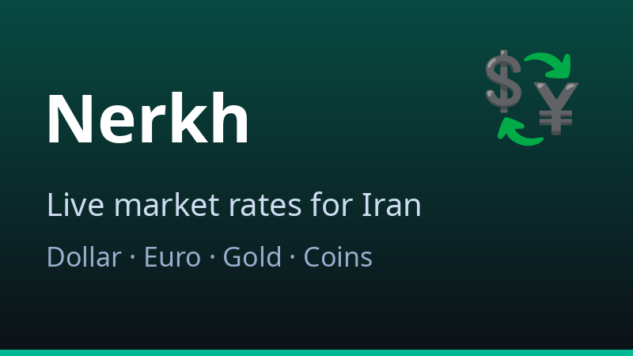
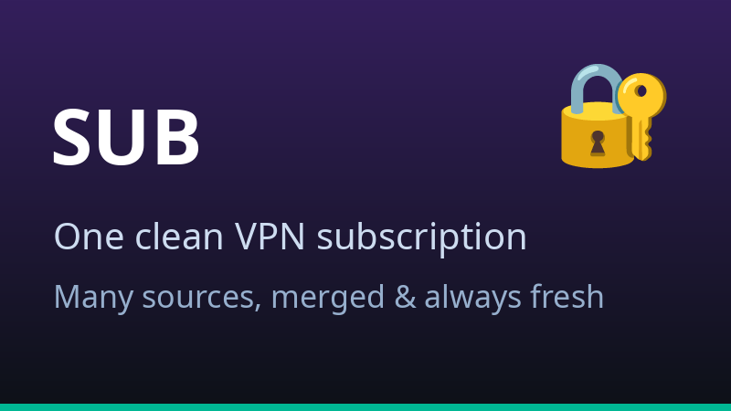
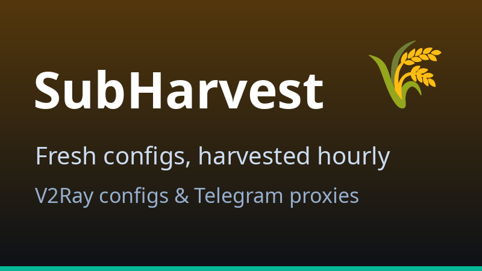

🌐 **English** · [فارسی](https://github.com/Ashollii/Ashollii/blob/main/README.fa.md)

## 👋 Hi, I'm Ashkan

 I'm a developer from **Iran** who builds **Telegram bots, small web tools and automation**. Everything here runs by itself — if a task repeats, a workflow does it.

**New to GitHub?** No problem: just click any picture below to visit that project, and use the ▶ links to open the live sites.

## 🚀 My projects

<table>
<tr>
<td width="33%" valign="top">
 
<b>💱 Nerkh — today's prices at a glance</b> 
Dollar, euro, gold and coin prices in Iran, with history charts. Always up to date. 
<a href="https://ashollii.github.io/Nerkh/"><b>▶ Open the live site</b></a> · <a href="https://github.com/Ashollii/Nerkh">Project page</a>
</td>
<td width="33%" valign="top">
 
<b>🔐 SUB — one clean VPN subscription</b> 
Several public sources combined into a single tidy subscription that refreshes itself. 
<a href="https://github.com/Ashollii/SUB"><b>▶ Get the subscription</b></a>
</td>
<td width="33%" valign="top">
 
<b>🌾 SubHarvest — fresh configs every hour</b> 
Collects V2Ray configs and Telegram proxies from public channels and republishes them, ready to import. 
<a href="https://github.com/Ashollii/SubHarvest"><b>▶ See the latest harvest</b></a>
</td>
</tr>
</table>

<!-- HARVEST:START -->
🌾 **SubHarvest pulse** — **359** configs & **394** proxies ready to use · last harvest: 2026-11-11 06:20 (Tehran)
<!-- HARVEST:END -->

## 📊 My GitHub in numbers

<b>💱 Live market rates — click to open (auto-updated hourly)</b>

 

<!-- RATES:START -->
| | Rate (Toman) |
|---|---|
| 💵 US Dollar | 261,586 |
| 💶 Euro | 291,800 |
| ✨ Gold 18k (per gram) | 25,762,960 |
| 🪙 Emami Coin | 254,000,000 |

⏰ Last update: 2026-11-11 10:32:30 (Tehran) · Source: [Nerkh](https://github.com/Ashollii/Nerkh)
<!-- RATES:END -->

<b>🧰 Toolbox &amp; behind the scenes — click to open</b>

 

Behind the scenes, a small fleet of Telegram bots keeps all of this running: a live rates bot, a subscription manager and a Telegram↔Bale bridge — self-healing, watched every few minutes, and quietly fixed before anyone notices.

## 📌 Right now

- Keeping **Nerkh** rates fresh minute-by-minute ⏱
- Growing the merged **SUB** and the **SubHarvest** pipeline 🌾
- Everything runs on automation — if it repeats, a workflow does it 🤖

**📬 Reach me on Telegram → [@A5HKANI](https://t.me/A5HKANI)**

